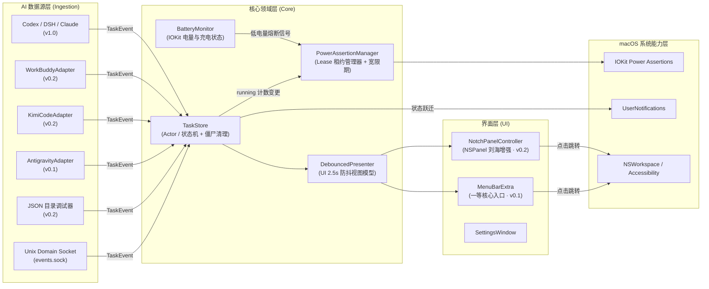
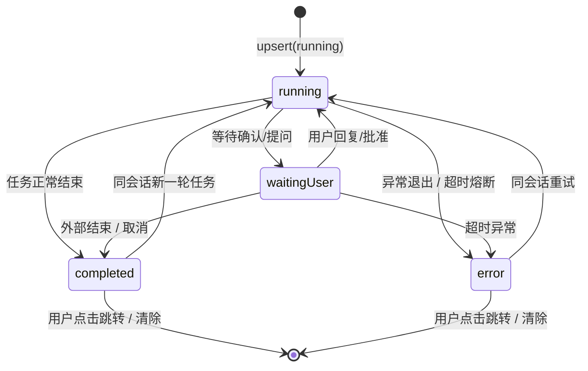

# CodePilot 技术设计文档（Technical Design Document）

> **版本**：v1.1（已完成 GPT/Codex 底层工程评审加固）  
> **对应需求文档**：[PRD.md](file:///Users/tianye/.gemini/antigravity/brain/6f63ee59-e1b9-4ebb-ab70-cc0ac9f82990/PRD.md)（v0.2）  
> **工程路径**：`/Users/tianye/.gemini/antigravity/scratch/CodePilot`  
> **运行环境**：macOS 14.0+（Sonoma 及以上），Swift 5.10 / Swift 6 并发安全模型，Apple Silicon 优先（可编译 Universal）

---

## 1. 系统总体架构

CodePilot 采用 **单向事件流 + 模块化解耦** 架构，所有外部 AI 工具（无论是 Hook 推送还是本地日志/SQLite 采集）全部收敛为统一的 `TaskEvent` 流，驱动 `TaskStore` 状态机，再由状态机联动 `PowerAssertionManager`（防休眠）、`NotificationService`（提醒）和 UI 层（菜单栏 + 刘海）。



---

## 2. 工程构建与目录结构

### 2.1 构建方式选型：Swift Package Manager + 轻量 `.app` 打包脚本
- **为什么不用传统 `.xcodeproj` 起步**：SwiftPM（`Package.swift`）无 XML/pbxproj 合并冲突，命令行 `swift build` / `swift test` 极速迭代，且可直接用 Xcode 打开调试。
- **打包为可双击运行的 `.app`**：提供一个 `scripts/bundle_app.sh` 脚本，将 `swift build -c release` 产物组装为 `CodePilot.app`（写入 `Info.plist`、`LSUIElement=true` 隐藏 Dock 图标、本地 ad-hoc 签名 `codesign --force --deep --sign -`）。
- **零重型第三方依赖**：全部基于 Apple 原生框架（`SwiftUI`、`AppKit`、`IOKit`、`UserNotifications`、`SQLite3`、`CoreServices`、`Network` / POSIX socket）。

### 2.2 代码目录规划

```text
CodePilot/
├── Package.swift
├── scripts/
│   ├── bundle_app.sh              # 打包 CodePilot.app 并本地签名
│   └── mock_event.py              # 模拟 AI 事件的 CLI 联调工具
├── Resources/
│   └── Info.plist                 # LSUIElement=true, BundleID=com.codepilot.app
├── Sources/
│   └── CodePilot/
│       ├── App/
│       │   ├── CodePilotApp.swift         # @main 入口，装配 MenuBarExtra 与 Settings
│       │   └── AppCoordinator.swift       # 生命周期管理、启动顺序与依赖注入
│       ├── Core/
│       │   ├── Models/
│       │   │   ├── TaskModels.swift       # TaskKey, TaskStatus, AgentTask, TaskEvent
│       │   │   └── SettingsModels.swift   # AppSettings (UserDefaults / Codable)
│       │   ├── StateMachine/
│       │   │   ├── TaskStore.swift        # 权威状态机 (Actor / @MainActor)
│       │   │   ├── ZombieSweeper.swift    # 心跳超时与 PID 存活清理
│       │   │   └── DebouncedPresenter.swift # UI 弹窗/音效 2.5s 防抖
│       │   └── Power/
│       │       ├── PowerLease.swift       # Lease 模型与优先级
│       │       ├── PowerAssertionManager.swift # IOKit 断言 + 宽限期定时器
│       │       └── BatteryMonitor.swift   # IOPSCopyPowerSourcesInfo 监听
│       ├── Ingestion/
│       │   ├── Protocol/
│       │   │   ├── EventEnvelope.swift    # NDJSON 协议编解码
│       │   │   └── UnixSocketServer.swift # POSIX AF_UNIX 异步服务端
│       │   ├── Helpers/
│       │   │   ├── FSEventWatcher.swift   # CoreServices FSEvents 封装
│       │   │   ├── JSONLTailer.swift      # inode + offset 增量读取器
│       │   │   └── ReadOnlySQLite.swift   # 短连接 SQLITE_OPEN_READONLY + 退避重试
│       │   └── Adapters/
│       │       ├── AgentAdapter.swift     # 适配器协议
│       │       ├── AntigravityAdapter.swift # v0.1 首发
│       │       ├── KimiCodeAdapter.swift    # v0.2
│       │       └── WorkBuddyAdapter.swift   # v0.2
│       ├── Services/
│       │   ├── NotificationService.swift  # UNUserNotificationCenter 封装
│       │   └── FocusJumpService.swift     # NSWorkspace 激活 App + v1.0 AX 跳转
│       └── UI/
│           ├── MenuBar/
│           │   ├── MenuBarIconView.swift  # 动态状态图标 + 防休眠徽标
│           │   ├── MenuBarPopoverView.swift # 主面板（防休眠条 + 任务分组列表）
│           │   └── TaskRowView.swift
│           ├── Settings/
│           │   └── SettingsView.swift     # 通用 / 工具连接诊断 / 防休眠设置
│           └── Notch/                     # v0.2 预留
│               └── NotchPanelController.swift
└── Tests/
    └── CodePilotTests/
        ├── TaskStoreTests.swift
        ├── PowerAssertionManagerTests.swift
        ├── JSONLTailerTests.swift
        └── EventEnvelopeTests.swift
```

---

## 3. 核心数据模型与状态机设计

### 3.1 核心模型定义（Swift 伪代码）

```swift
enum AgentSource: String, Codable, Hashable, CaseIterable {
    case antigravity
    case kimiCode = "kimi_code"
    case workbuddy
    case codex
    case deepseekHarness = "deepseek_harness"
    case claudeCode = "claude_code"
    case custom
}

struct TaskKey: Hashable, Codable {
    let source: AgentSource
    let sessionId: String
    let taskId: String
}

enum TaskStatus: String, Codable {
    case running
    case waitingUser = "waiting_user"
    case completed
    case error
}

struct AgentTask: Identifiable, Equatable {
    var id: TaskKey { key }
    let key: TaskKey
    var title: String
    var status: TaskStatus
    var lastSeq: UInt64
    var startedAt: Date
    var updatedAt: Date
    var lastHeartbeatAt: Date
    var appBundleId: String?
    var cwd: String?
    var pid: Int32?
    var message: String? // 可选简短提示，如“等待批准终端命令”
}
```

### 3.2 状态流转与一致性规则



**关键防线（已吸收 GPT 评审加固）**：
1. **防乱序与重启重置（`epoch + seq`）**：
   - 事件新增 `epoch`（适配器启动 UUID 或进程启动标识）。同一 `(TaskKey, epoch)` 内严格要求 `event.seq >= existing.lastSeq`；若收到新 `epoch`，允许序号重置，避免适配器或宿主工具重启后 `seq=1` 被误丢弃。
2. **僵尸任务清理与防 PID 复用（`ZombieSweeper`）**：
   - 每 30 秒扫描 `running` 任务。
   - 若记录了 `pid`，首次记录时同步通过 `proc_pidinfo(..., PROC_PIDTBSDINFO, ...)` 保存进程启动时间 `procStartTime`；巡检时仅当 `kill(pid, 0) != 0 && errno == ESRCH` **或** 进程启动时间已变化（说明原进程已退出且 PID 被复用）才自动归档。
   - 若 `errno == EPERM`（跨权限不可探活），不误判退出，降级依赖心跳超时（默认 600 秒）归档。
3. **状态一致性 vs UI 防抖解耦**：
   - `TaskStore` **即时更新**权威状态并通知 `PowerAssertionManager`（确保防休眠零延迟）。
   - `DebouncedPresenter` 对 `running → waitingUser / completed` 的**弹窗与音效通知**施加 2.5 秒防抖窗口：若 2.5 秒内又切回 `running`（例如工具调用之间的短暂间隙），则取消本次打扰通知。

---

## 4. Unix Domain Socket 本地开放协议规范（v1）

### 4.1 传输层与安全约定（规避 104 字节路径上限与权限竞态）
- **Socket 路径**：`~/.codepilot/events.sock`（避开 `Application Support` 长路径触发 macOS `sockaddr_un.sun_path` 104 字节上限）。
- **安全创建与清理**：
  - 启动前用 `lstat` 确认旧路径为当前用户所有的 `S_IFSOCK` 后再 `unlink`，绝不误删普通文件。
  - 创建目录权限 `0700`，`bind` 前设置 `umask(0077)` 消除 `chmod` 竞态，并给监听 fd 设置 `FD_CLOEXEC` 防止被子进程继承。
  - 接受连接后通过 macOS 原生 `getpeereid(fd, &euid, &egid)` 校验对端 `euid == getuid()`，拒绝非当前用户连接。
- **连接健壮性**：单连接独立异步读写任务，限制最大并发连接数（如 64）、单行上限 64 KB、读写超时（5 秒）；遇到 EOF、半关闭或慢客户端无法写出 ACK 时立即关闭清理。
- **帧格式**：**NDJSON**（Newline-Delimited JSON），UTF-8 编码，每条消息以 `\n` 结尾。

### 4.2 消息 Schema

**客户端推送（Request）**：
```json
{
  "v": 1,
  "type": "upsert",
  "source": "antigravity",
  "epoch": "boot-9f2a",
  "sessionId": "6f63ee59-e1b9-4ebb-ab70-cc0ac9f82990",
  "taskId": "main",
  "seq": 42,
  "status": "waiting_user",
  "title": "CodePilot 技术设计评审",
  "message": "等待确认技术方案",
  "appBundleId": "com.google.antigravity",
  "cwd": "/Users/tianye/.gemini/antigravity/scratch/CodePilot",
  "pid": 18422,
  "ts": 1795435483.12
}
```
- `type` 取值：`upsert`（创建/更新任务）、`heartbeat`（续命心跳）、`remove`（主动清除）。

**服务端响应（ACK）**：
```json
{"ok": true, "seq": 42}
```
错误时返回：
```json
{"ok": false, "error": "invalid_json"}
```

### 4.3 Hook 极简接入示例（1 行命令即可接入任意工具）
```bash
printf '{"v":1,"type":"upsert","source":"claude_code","epoch":"s1","sessionId":"s1","taskId":"t1","seq":1,"status":"waiting_user","title":"等待批准命令"}\n' \
  | nc -U "$HOME/.codepilot/events.sock"
```

---

## 5. PowerAssertionManager（Lease 防休眠引擎）设计

### 5.1 Lease 模型与优先级

```swift
enum PowerAssertionLevel: Int, Comparable {
    case systemOnly = 1      // kIOPMAssertionTypePreventUserIdleSystemSleep
    case systemAndDisplay = 2 // kIOPMAssertionTypePreventUserIdleDisplaySleep
    static func < (lhs: Self, rhs: Self) -> Bool { lhs.rawValue < rhs.rawValue }
}

enum PowerLeaseKind: Hashable {
    case manualIndefinite
    case manualTimed(id: UUID)
    case processRule(name: String) // v1.0
    case aiAuto
}

struct PowerLease {
    let kind: PowerLeaseKind
    let reason: String
    let level: PowerAssertionLevel
    let createdAt: Date
    let expiresAt: Date?
}
```

### 5.2 状态同步算法（`reconcile()`）
每次 Lease 集合变化（增/删/到期/低电量事件）时，在串行队列/Actor 内执行幂等对账：
1. 计算当前所有**有效 Lease** 所需的最高级别：`targetLevel = activeLeases.map(\.level).max()`。
2. 若 `targetLevel == nil`：若当前持有 IOKit Assertion，调用 `IOPMAssertionRelease(currentID)` 并置空。
3. 若 `targetLevel != currentLevel`：
   - **先创建新断言，再释放旧断言**（Make-Before-Break），避免切换瞬间系统出现休眠窗口。
   - 若创建返回非 `kIOReturnSuccess`，记录错误并在 UI 展示告警状态。

### 5.3 AI 自动联动、单调计时与休眠唤醒校准
- **单调时钟**：所有宽限期（Grace Period）与手动定时 Lease 均基于 `ContinuousClock.Instant`（而非 `Date`）计算截止点，防止系统校时跳变导致提前释放或永久挂起。
- 当 `TaskStore` 中 `runningCount` 从 `0 → ≥1`：
  1. 取消正在运行的 `graceTimer`（如有）。
  2. 向 `PowerAssertionManager` 申请 `.aiAuto` Lease（级别由用户设置决定：默认 `.systemOnly`）。
- 当 `runningCount` 从 `≥1 → 0`：
  1. 不立刻释放，启动 `graceTimer`（默认 180 秒）。
  2. 若宽限期结束前无新 `running` 任务到来，到期仅释放 `.aiAuto` Lease。
- **系统唤醒校准**：监听 `NSWorkspace.didWakeNotification`，唤醒后立即向 `PowerAssertionManager` 串行队列投递校准任务：重新评估已过期 Lease、重算剩余 `graceTimer`、并校验/重建 IOKit 断言句柄（IOKit 回调本身绝不直接修改 Lease 或操作 UI）。

### 5.4 电池与低电量熔断（`BatteryMonitor`）
- 使用 `IOPSNotificationCreateRunLoopSource` 注册系统电源变更回调，通过 `IOPSCopyPowerSourcesInfo()` 读取：
  - `kIOPSPowerSourceStateKey`（`AC Power` vs `Battery Power`）
  - `kIOPSCurrentCapacityKey`（当前电量百分比）
- **熔断逻辑**：
  - 当处于 `Battery Power` 且电量 `≤ lowBatteryThreshold`（默认 20%）时：
    - 立即释放 `.aiAuto` Lease，并设置 `isAutoBlockedByLowBattery = true`，发出系统通知。
    - 对于 `.manualIndefinite` / `.manualTimed`，仅当用户开启「低电量同时停止手动保活」时才释放，否则仅发预警通知。
  - 当重新接通 `AC Power` 或电量恢复至 `threshold + 5%`（迟滞回差，防 20% 临界点抖动）时，解除熔断并重新对账。

---

## 6. AI 工具适配器详细设计

所有适配器实现统一协议：
```swift
protocol AgentAdapter: AnyObject {
    var source: AgentSource { get }
    var healthStatus: AdapterHealth { get } // .active, .notInstalled, .permissionDenied, .error(String)
    func start(emit: @escaping @Sendable (TaskEvent) -> Void)
    func stop()
}
```

### 6.1 `AntigravityAdapter`（v0.1 首发）
- **监听路径**：`~/.gemini/antigravity/brain/`
- **双通道策略**：
  1. **原生文件监听（开箱即用）**：使用 `FSEvents` 监听 `brain/<conversation-id>/.system_generated/logs/transcript.jsonl` 变更，通过 `JSONLTailer` 增量读取新增行。
  2. **字段解析映射**：
     - 读取最近有效 JSON 行的 `type`、`status`、`tool_calls` 字段。
     - `USER_INPUT` 或 `PLANNER_RESPONSE` 且 `status != "DONE"` → `running`。
     - `tool_calls` 含 `ask_question` 或等待用户审批/输入信号 → `waiting_user`。
     - `PLANNER_RESPONSE` 且 `status == "DONE"` 且无后续挂起工具调用 → `completed`。
     - `status == "ERROR"` → `error`。
  3. **Hook 增强通道（可选）**：允许通过 Antigravity Hook 直接向 `events.sock` 推送精确状态，同 `TaskKey` 下以最新 `seq`/`ts` 为准。
- **权限兼容**：由于 sandbox 限制或目录不存在时，适配器优雅降级为 `.notInstalled` / `.permissionDenied`，并在设置页给出明确路径提示。

### 6.2 `KimiCodeAdapter`（v0.2）
- **实测路径**：`~/.kimi-code/session_index.jsonl`（每行含 `sessionId`、`sessionDir`、`workDir`）及 `~/.kimi-code/sessions/`、`~/.kimi-code/locks/`。
- **采集方式**：
  1. `JSONLTailer` 监听 `session_index.jsonl` 维护活跃会话索引与 `workDir`（用于展示项目名和跳转）。
  2. 监听活跃 `sessionDir` 内对话日志增量，结合 `~/.kimi-code/locks/` 判断会话是否正在执行，映射为 `running` / `waiting_user` / `completed`。

### 6.3 `WorkBuddyAdapter`（v0.2）
- **实测路径**：`~/.workbuddy/workbuddy.db`（WAL 模式）、`~/.workbuddy/sessions/*.json`、`~/.workbuddy/tasks/`。
- **采集方式（严格防锁库）**：
  1. `FSEvents` 监听 `workbuddy.db-wal` 与 `sessions/` 的 mtime 变更（带 500ms 合并节流，不做无意义空轮询）。
  2. 触发后通过 `ReadOnlySQLite` 打开短连接（`SQLITE_OPEN_READONLY | SQLITE_OPEN_NOMUTEX`，设置 `PRAGMA busy_timeout = 200; PRAGMA query_only = ON;`），读取：
     - `sessions` 表（最近活跃会话标题与状态）
     - `session_turn_interruptions` 表（识别等待用户确认/中断状态 → `waiting_user`）
     - `automation_runtime_state` 表（后台自动化任务运行状态 → `running`）
  3. 查询完毕**立即 `sqlite3_close`**，若遇 `SQLITE_BUSY` 则指数退避重试（200ms → 500ms → 1s，最多 3 次），绝不影响 WorkBuddy 主程序运行。

### 6.4 通用 `JSONLTailer` 与 `FSEvents` 健壮性设计
- **按需短打开（防 FD 耗尽）**：`FSEvents` 仅作为目录级 dirty 信号触发器，不长期持有每个历史会话文件的 FD；收到通知后在独立串行队列上按需打开目标文件读取增量并立即 `close`。
- **冷启动限流**：应用冷启动时仅扫描最近活跃文件（例如 24 小时内有写入的会话），且大文件只从末尾窗口（如最后 64 KB）初始化当前状态，不回放全量历史，避免阻塞主线程。
- **增量状态追踪**：记录每个文件的 `(inode, byteOffset, partialLineBuffer)`：
  - 若 `stat.st_ino != savedInode || stat.st_size < byteOffset`（文件轮转/替换/截断），重置 `byteOffset = 0` 与 `partialLineBuffer`。
  - 仅读取 `[byteOffset, st_size)` 字节；末尾非 `\n` 时暂存 `partialLineBuffer`，等下次写入补全后再解析；单行超长或 JSON 损坏时跳过并记 debug 日志。

### 6.5 打包、通知授权与 `LSUIElement` 降级策略
- `bundle_app.sh` 固定 `CFBundleIdentifier`（`com.codepilot.app`）与 `Info.plist`，并对整个 `.app` 执行一致性签名。
- **通知降级**：由于本地 ad-hoc 签名下 `UNUserNotificationCenter` 授权状态偶发不稳定，启动时检测授权状态；若未授权或通知注册失败，自动降级为菜单栏红点 + 音效提醒，不影响核心监控与防休眠。
- **窗口激活**：由于设置了 `LSUIElement = true`（无 Dock 图标），打开设置窗口时必须显式调用 `NSApp.activate(ignoringOtherApps: true)` 确保窗口前置。

---

## 7. 刘海悬浮窗（Notch）与跳转服务设计

### 7.1 `NotchPanelController`（v0.2）
- 使用自定义 `NSPanel` 子类：
  - `styleMask = [.borderless, .nonactivatingPanel]`（点击不抢占当前编辑器的键盘焦点，直到用户主动点击某条任务跳转）。
  - `level = .statusBar`
  - `collectionBehavior = [.canJoinAllSpaces, .fullScreenAuxiliary, .ignoresCycle]`
- **屏幕适配**：监听 `NSApplication.didChangeScreenParametersNotification`：
  - 通过 `screen.safeAreaInsets.top > 0` 判断是否有硬件刘海。
  - 有刘海：锚定在刘海几何中心并平滑展开。
  - 无刘海（如外接显示器）：降级为屏幕顶部居中、距顶 6pt 的黑色胶囊药丸。
- **全屏避让**：检测前台激活 App 的主窗口 frame 是否覆盖 `screen.frame`（无菜单栏可见），若处于全屏态则自动收起刘海悬浮窗。

### 7.2 `FocusJumpService`
- **v0.1**：根据任务的 `appBundleId`（例如 `Antigravity.app` / `WorkBuddy.app` / `Kimi Code.app`），通过 `NSWorkspace.shared.runningApplications` 找到实例并调用 `activate(options: .activateIgnoringOtherApps)`。
- **v1.0**：对于 CLI 任务（如终端内运行的 `kimi` / `codex` / `claude`），若用户已授予 Accessibility 权限，通过 `AXUIElement` / AppleScript 按 `cwd` 匹配 iTerm2 / Ghostty / Terminal / VS Code 对应窗口或 Tab 并前置。

---

## 8. 测试与验证策略

### 8.1 单元测试（`swift test`）
1. **`TaskStoreTests`**：验证正常流转、乱序 `seq` 拒绝、相同事件幂等、PID 退出与心跳超时僵尸清理。
2. **`PowerAssertionManagerTests`**：使用 `MockPowerAssertionBackend` 注入，验证：
   - 多 Lease 并发（手动 + 自动）互不误释放；
   - 宽限期倒计时被新 `running` 任务打断并取消；
   - 低电量仅熔断 `.aiAuto`，不影响手动 Lease，且有 5% 迟滞恢复；
   - 级别升级（`systemOnly` → `systemAndDisplay`）遵循 Make-Before-Break。
3. **`JSONLTailerTests`**：验证半行截断拼接、乱码行跳过、文件轮转重置。
4. **`EventEnvelopeTests`**：验证 Unix Socket 粘包/分包 NDJSON 解析与非法帧报错。

### 8.2 端到端联调（`scripts/mock_event.py`）
提供命令行模拟脚本，在真正接入各 AI 工具前，可一键模拟：
- `running` → 检查 `pmset -g assertions` 确认系统防休眠断言已生效；
- `waiting_user` → 检查菜单栏红点、系统通知弹出；
- `completed` → 检查宽限期倒计时及到期后 `pmset -g assertions` 断言释放。

---

## 9. 下一阶段实施清单（v0.1 开工顺序）

1. 初始化 `/Users/tianye/.gemini/antigravity/scratch/CodePilot` SwiftPM 工程与 `bundle_app.sh`。
2. 实现核心层：`TaskModels` + `TaskStore` + `ZombieSweeper` + 单元测试。
3. 实现电源层：`PowerAssertionManager` + `BatteryMonitor` + 单元测试（实机 `pmset -g assertions` 验证）。
4. 实现接入层：`UnixSocketServer` + `JSONLTailer` + `AntigravityAdapter`。
5. 实现 UI 层：`MenuBarExtra` 图标与主面板 + `NotificationService` + `FocusJumpService` + 基础 `SettingsView`。
6. 本地编译打包 `CodePilot.app` 并实机试跑验收。
