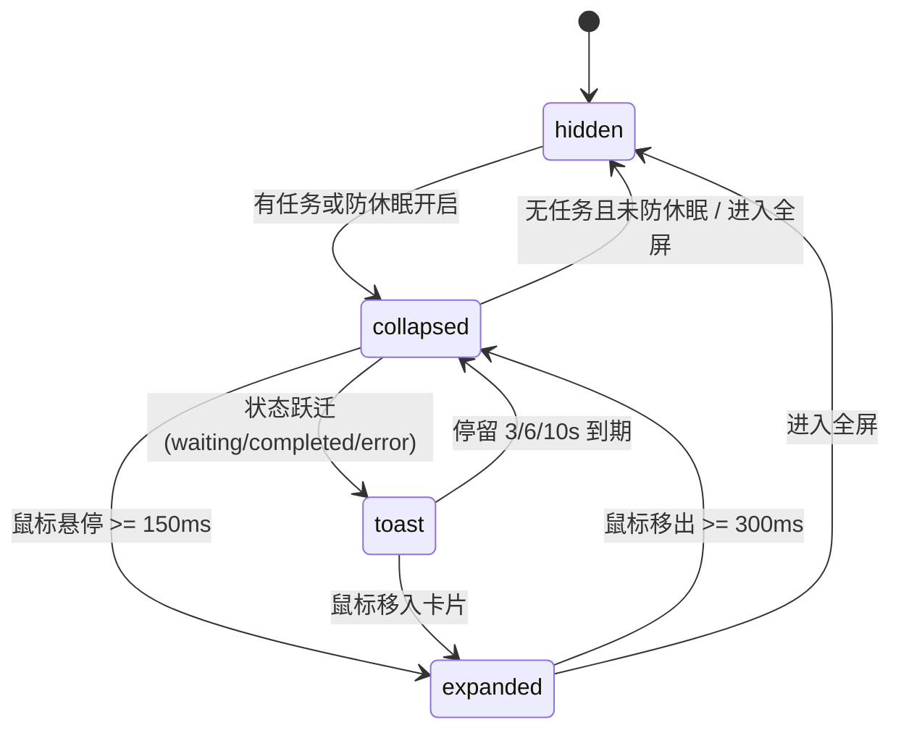

# CodePilot v0.2 技术设计文档（Technical Design Document）

> **版本**：v0.2.1（已完成 Codex 架构评审加固定稿）  
> **对应需求文档**：[PRD_v0.2.md](file:///Users/tianye/.gemini/antigravity/brain/6f63ee59-e1b9-4ebb-ab70-cc0ac9f82990/PRD_v0.2.md)（v0.2.1）  
> **底座依赖**：基于 v0.1 已验收的 `TaskStore`、`PowerAssertionManager`（Lease）、`UnixSocketServer`、`JSONLTailer`、`FSEventWatcher`（20/20 单测通过，M4 收口 Review 已修复）。

---

## 1. v0.2 增量架构与文件规划

```text
Sources/
├── CodePilotCore/
│   ├── Core/
│   │   ├── Models/
│   │   │   ├── TaskModels.swift              # [更新] 新增 provenLive, deepLinkURL, ReadAckLevel
│   │   │   └── SettingsModels.swift          # [更新] 新增 6 工具独立开关、刘海开关/停留时长、二次提醒配置
│   │   └── StateMachine/
│   │       ├── TaskStore.swift               # [更新] Priming 三分类、confirmedRunningCount、分级已读消红点
│   │       └── DebouncedPresenter.swift      # [更新] 支持 waiting_user 超时二次提醒（最多 3 次）与切入 App 静音
│   ├── Ingestion/
│   │   ├── Helpers/
│   │   │   ├── ReadOnlySQLite.swift          # [新增] 短连接只读 SQLite3 + busy_timeout + 退避重试
│   │   │   └── FileLockProbe.swift           # [新增] 非阻塞 flock(LOCK_EX | LOCK_NB) 真实锁探活
│   │   └── Adapters/
│   │       ├── AdapterRegistry.swift         # [新增] 统一管理 6 大适配器启停与健康状态
│   │       ├── AntigravityAdapter.swift      # [更新] Priming 标记 + 兼容 GENERIC/PLANNER_RESPONSE 真实字段
│   │       ├── DeepSeekHarnessAdapter.swift  # [新增 S1] 只读 session_projcache + session.lock 探活
│   │       ├── KimiCodeAdapter.swift         # [新增 S2] session_index.jsonl + sessions/ + locks/
│   │       ├── WorkBuddyAdapter.swift        # [新增 S2] workbuddy.db 短连接只读 + sessions/*.json 降级
│   │       ├── CodexAdapter.swift            # [新增 S2] rollout-*.jsonl + state_5.sqlite + global-state
│   │       └── ClaudeCodeAdapter.swift       # [新增 S2] projects/**/*.jsonl + local_*.json
│   └── Services/
│       ├── FocusJumpService.swift            # [更新] 优先 deepLinkURL (codex://, claude://) + 精确 App 激活
│       └── FrontmostAppMonitor.swift         # [新增] 监听 NSWorkspace.didActivateApplicationNotification
└── CodePilot/
    ├── App/
    │   └── AppCoordinator.swift              # [更新] 接入 AdapterRegistry、FrontmostAppMonitor、NotchPanelController
    └── UI/
        ├── MenuBar/
        │   └── MenuBarPopoverView.swift      # [更新] 修复 ScrollView 0px 塌陷 + 耗时计时器 + 高质感卡片
        ├── Notch/
        │   ├── NotchStateMachine.swift       # [新增 S3] hidden/collapsed/toast/expanded + enter/exit 防抖
        │   ├── NotchPanelController.swift    # [新增 S3] NSPanel 定位、NSTrackingArea、全屏避让、无刘海药丸降级
        │   └── NotchContentView.swift        # [新增 S3] 刘海静默态/弹出态/展开态（含防休眠控制条）
        └── Settings/
            └── SettingsView.swift            # [更新] 6 工具独立开关与健康诊断、刘海与二次提醒配置
```

---

## 2. Priming 三分类与防休眠隔离设计

为彻底解决「冷启动扫描历史会话误弹通知 / 误触发防休眠」问题：

### 2.1 模型扩展
- `TaskEvent` 新增两个字段：
  - `isPriming: Bool = false`（冷启动基线扫描发出的事件标记为 `true`）
  - `provenLive: Bool = true`（实时事件默认 `true`；冷启动扫描时仅当通过有效文件锁、存活 PID 或最近 60 秒内新写入证实活跃才为 `true`，否则为 `false`）
  - `deepLinkURL: String? = nil`（如 `codex://threads/<id>`、`claude://code/continue?session=<id>`）
- `AgentTask` 新增：
  - `provenLive: Bool`
  - `deepLinkURL: String?`

### 2.2 状态机行为
1. **`confirmedRunningCount`**：`TaskStoreSnapshot` 新增 `confirmedRunningCount = tasks.filter { $0.status == .running && $0.provenLive }.count`。
2. **防休眠只绑定 `confirmedRunningCount`**：`PowerAssertionManager.updateRunningTaskCount(snap.confirmedRunningCount)`。冷启动扫描到的历史/无法确认存活的会话绝不会误续租 `.aiAuto`。
3. **提醒隔离**：`TaskEvent.isPriming == true` 时，`TaskStore.apply` 正常写入任务状态，但返回 `shouldNotify = false`，不触发 `DebouncedAlertCoordinator` 与刘海 Toast。

---

## 3. 分级已读消红点与超时二次提醒

### 3.1 分级已读策略（`ReadAckLevel`）
- `.seenByApp(AgentSource)`：由 `FrontmostAppMonitor` 在用户切回对应 App 时触发。
  - **动作**：仅调用 `alertCoordinator.silenceReminders(for: source)` 停止重复提醒，**不删除** `completed` 任务（防 IDE 场景误消）。
- `.openedSession(TaskKey)`：适配器检测到目标具体会话已被打开/已读（如 Codex `.codex-global-state.json` 的 `unreadByIdentity` 清除）。
  - **动作**：若该任务为 `completed`，自动从 `TaskStore` 移除。
- `.userConfirmed(TaskKey)`：用户点击菜单栏/刘海任务卡片跳转，或点击「清除已完成」。
  - **动作**：立即移除对应已完成任务。

### 3.2 `waiting_user` 超时二次提醒（S1 前置实现）
- 扩展 `DebouncedAlertCoordinator`：
  - 任务首次进入 `waiting_user` 并在 2.5s 防抖后触发首次提醒；
  - 若 `settings.repeatReminderEnabled == true`，基于 `ContinuousClock` 启动周期提醒任务：每隔 `repeatReminderIntervalSeconds`（默认 300s）检查该任务是否仍在 `waiting_user` 且未被 `seenByApp` 静音，最多重复 `maxRepeatReminders` 次（默认 3 次）；
  - 一旦任务离开 `waiting_user`、用户切入该工具 App 或应用 `shutdown()`，立即取消该任务的提醒 Timer。

---

## 4. 6 大零侵入适配器技术详设

### 4.1 `DeepSeekHarnessAdapter`（S1）
- **数据源（纯只读，不修改 `~/.dsh/profiles`）**：
  - 投影缓存：`~/.dsh/storages/session_projcache/sessions/session-*.json`
  - 活跃锁目录：`~/.dsh/sessions/*/*/session.lock`
- **多策略锁探活（`LockProbe`，不干扰宿主锁竞争）**：
  - 优先只读解析 `session.lock` 文本/JSON 中的 `pid`，交由 `POSIXProcessInspector` 校验进程存活与启动时间（`ESRCH` 判死、`EPERM` 降级）；
  - 不对只读 fd 强行执行排他 `flock(LOCK_EX)`，将锁信号作为辅助证据，与投影缓存 `turnBoundary` 和文件 `mtime` 新鲜度交叉判定。
- **状态映射**：
  - 解析 `session-*.json`（捕获 JSON 半写异常，失败时延迟 200ms 重试 1 次）：
    - 存在未回答的 `userQuestions` → `waiting_user`；
    - `turnBoundary` 表明回合进行中 **且**（锁进程存活 或 文件 mtime < 120s）→ `running`（`provenLive = true`）；
    - 回合已结束 → `completed`。

### 4.2 `AntigravityAdapter`（S1 优化）
- 兼容真实 `transcript.jsonl` 字段：`USER_INPUT` / `PLANNER_RESPONSE` / `GENERIC`；
- 冷启动 24h 内活跃会话以 `isPriming = true` 扫描，仅 mtime < 90s 且最后一步非 `DONE` 时标记 `provenLive = true`。

### 4.3 `KimiCodeAdapter`（S2）
- 监听 `~/.kimi-code/session_index.jsonl`（字段 `sessionId`、`sessionDir`、`workDir`）与 `~/.kimi-code/locks/`；
- 用 `FileLockProbe` 验证锁活性，结合 `sessionDir` 内最新事件映射状态，标题优先展示 `workDir` 项目名 + 首条用户输入。

### 4.4 `WorkBuddyAdapter`（S2）
- 通过 `AdapterRefreshCoalescer` 合并 `~/.workbuddy/workbuddy.db-wal` 与 `~/.workbuddy/sessions/` 的变更（300~500ms 节流合并 + `generation` 丢弃过期刷新 + 连续失败指数退避）。
- **主路径（`ReadOnlySQLite` 安全快照，禁止对 live WAL 使用 `immutable=1`）**：
  - 优先采用短连接只读（`SQLITE_OPEN_READONLY | SQLITE_OPEN_NOMUTEX` + `PRAGMA query_only = ON; PRAGMA busy_timeout = 200;`）；若遇目录只读或 `-shm` 竞争，自动回退为将 `.db` + `-wal` + `-shm` 复制到临时目录做只读快照查询（复制前后核对 mtime/size 一致性）后立刻清理临时副本；
  - 读取最近 24h 更新的 `sessions`、`session_turn_interruptions`、`automation_runtime_state` 后立即 `sqlite3_close(db)`。
- **降级路径**：若连续 3 次遇到 `SQLITE_BUSY` 或表结构变更（`SQLITE_ERROR`），自动降级为只读监听 `~/.workbuddy/sessions/*.json` 并在健康状态标注「已降级为 JSON 模式」。

### 4.7 统一事件汇聚与防风暴（`AdapterRefreshCoalescer`）
- 6 大适配器共享统一的节流合并机制：按 `(source, targetKey)` 使用 `ContinuousClock` 做 300ms 合并去重，单适配器内串行刷新并携带单调 `generation` 丢弃过期结果，连续错误自动指数退避（0.5s → 1s → 2s → 上限 10s）。

### 4.8 `deepLinkURL` 严格白名单校验（`FocusJumpService`）
- 打开 `deepLinkURL` 前必须经 `URLComponents` 严格校验：
  - 仅允许白名单格式：`codex://threads/<alnum-_>` 与 `claude://code/continue?session=<alnum-_>`；
  - 拒绝带 `user`/`password`/`port`、多余 query 参数、路径穿越或非法字符的 URL，防止本地事件注入任意 URL scheme。

### 4.5 `CodexAdapter`（S2）
- `FSEvents` 监听 `~/.codex/sessions/` 下最新 `rollout-*.jsonl`（通过 `JSONLTailer` 增量解析 `task_started` / `task_complete` / `turn_aborted` / `request_user_input` / `*approval_request`，过滤 subagent）；
- 短连接只读 `~/.codex/state_5.sqlite` 的 `threads.name` 获取短标题（30s 缓存）；
- 读取 `~/.codex/.codex-global-state.json` 检查已读态，发射 `.openedSession` 自动消红点；
- `deepLinkURL = "codex://threads/\(threadId)"`。

### 4.6 `ClaudeCodeAdapter`（S2）
- `FSEvents` 监听 `~/.claude/projects/` 下最近活跃 `*.jsonl`（跳过 `subagents` 子目录），通过 `JSONLTailer` 增量解析 `stop_reason`（`tool_use` / `pause_turn`）与未回复的 `AskUserQuestion` / `ExitPlanMode`；
- 读取 `~/Library/Application Support/Claude/claude-code-sessions/local_*.json` 映射桌面端 `local_` ID，设置 `deepLinkURL = "claude://code/continue?session=\(desktopId)"`。

---

## 5. UI 重做与刘海（Notch）交互中心设计

### 5.1 菜单栏 Popover 0px 塌陷修复（S1）
- 原 `MenuBarPopoverView` 中 `ScrollView` 无固定高度在 `MenuBarExtra(.window)` 中被压为 0pt。
- **修复**：根据当前可见分组与任务数显式计算 `listHeight = min(360, max(120, estimatedRowsHeight))`，绑定 `.frame(height: listHeight)`，保证无论 1 条还是 10 条任务都完整渲染且不撑爆屏幕。
- **零空转耗时计时**：`TimelineView(.periodic(from: .now, by: 1), paused: !isVisible || runningCount == 0)` 仅在面板可见且存在运行中任务时运行，隐藏时完全暂停不耗电。

### 5.2 刘海悬浮窗（`NotchPanelController`，S3）



- **窗口配置**：
  - `NSPanel` 子类，`styleMask = [.borderless, .nonactivatingPanel]`，`isOpaque = false`，`backgroundColor = .clear`；
  - `level = .statusBar`，`collectionBehavior = [.canJoinAllSpaces, .fullScreenAuxiliary, .ignoresCycle]`；
  - `hasShadow = false`（展开态内部 SwiftUI 视图自绘柔和阴影）。
- **防跨屏漂移策略**：
  - 优先锚定**带硬件刘海的内置屏幕**（`NSScreen.screens.first { $0.safeAreaInsets.top > 0 }`）；
  - 若合盖仅外接无刘海显示器，则锚定 `NSScreen.main ?? NSScreen.screens.first`，以顶部居中黑色胶囊药丸形态（距顶 6pt）呈现，不随鼠标跨屏乱跳；
  - 监听 `NSApplication.didChangeScreenParametersNotification` 重新计算几何 frame。
- **全屏避让（防「自动隐藏菜单栏」误判）**：
  - 监听 `NSWorkspace.didActivateApplicationNotification`、`NSWorkspace.activeSpaceDidChangeNotification` 与 `didChangeScreenParametersNotification`；
  - 不单靠 `visibleFrame.maxY == frame.maxY` 判断全屏，而是结合 `CGWindowListCopyWindowInfo([.optionOnScreenOnly, .excludeDesktopElements], kCGNullWindowID)` 检查前台应用是否存在覆盖目标屏幕整屏（`bounds == screenFrame` 且 `layer == 0`）的全屏窗口，确认全屏态时切换至 `.hidden`，退出全屏后恢复。
- **一键开关**：设置页提供「启用刘海浮窗」总开关（默认开启），方便外接屏或偏好极简的用户随时关闭。

---

## 6. 测试与验收计划

1. **核心状态机单元测试**：
   - Priming 三分类：验证 `isPriming = true, provenLive = false` 不触发通知、不计入 `confirmedRunningCount`；`provenLive = true` 正常计入防休眠；
   - 分级已读：验证 `.seenByApp` 只停提醒不删任务，`.openedSession` / `.userConfirmed` 删除已完成任务；
   - 二次提醒：验证 `waiting_user` 超时重复触发（最多 3 次），切入 App 或状态变化立即取消。
2. **适配器单元测试**：
   - `DeepSeekHarnessAdapterTests`：mock `session_projcache` JSON（`userQuestions` / `turnBoundary`）+ `FileLockProbe` 真实 `flock` 活跃锁 vs 残留死锁；
   - `WorkBuddyAdapterTests`：临时 SQLite WAL 测试短连接只读 + 损坏库降级到 `sessions/*.json`；
   - `KimiCodeAdapterTests` / `CodexAdapterTests` / `ClaudeCodeAdapterTests`；
   - `NotchStateMachineTests`：验证 `hidden ↔ collapsed ↔ toast ↔ expanded` 防闪烁流转与全屏收起。
3. **真机实测验收**：
   - S1 结束时：直接用本机 **DeepSeek Harness** 和 **Antigravity** 真实跑任务验收；
   - S2 结束时：直接用本机 **Kimi Code** / **WorkBuddy** / **Codex** 验证；
   - S3 结束时：实机验收刘海弹出、悬停展开、全屏避让与防休眠联动。
